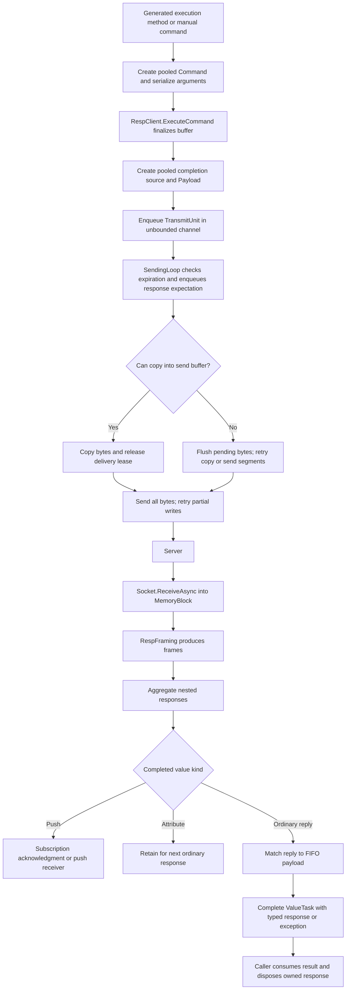

# Request, response, and ownership paths

Respsody aims to minimize CPU work, allocation, copying, and coordination per RESP/Redis operation. The paths below describe the current implementation; they do not establish that it is allocation-free or faster than other clients.

## A command on an established connection



The generated execution method builds a command inside `using`, calls `ExecuteCommand`, and returns its `ValueTask<T>`. It releases the command's ownership without waiting for the response. A manual caller owns its `Command<T>` and must dispose it separately from the response. `FinalizeCommand()` is internal: `ExecuteCommand` or `Pack` calls it. Its first call commits the segments and, for a normal manual command, writes the RESP array prefix. Generated commands use the internal serialization convention exposed by `@unsafe: true` and write that prefix themselves. Subsequent finalizations acquire another delivery lease for reuse.

The source generator emits command construction at compile time and combines static protocol fragments into UTF-8 literals where possible. Dynamic arguments still require runtime serialization; the generator removes repeated construction of constant protocol bytes.

`Payload` is a struct containing the completion source, response type, timing/cancellation information, and a newly allocated `CompletionGuard`. `Command<T>` and `PooledValueTaskCompletionSource<T>` use thread-local pools; `OutgoingBuffer` uses a pool associated with `MemoryBlocks`. Pool reuse avoids some allocations after warmup, but does not make every operation allocation-free. A published completion source returns to its pool when the caller consumes the result through `GetResult`, including an exceptional result. A failed `Pack` returns its unpublished source internally. Consume each returned `ValueTask` once.

The send and receive paths are asynchronous loops, not dedicated threads. The channel has multiple producers and one active consumer: the send loop while connected, or the expiration loop during connection establishment. Every connection attempt stops and awaits its expiration loop before moving on, including failed initialization. The receive loop parses, aggregates, dispatches pushes, and completes responses synchronously after each receive. `RunContinuationsAsynchronously` defaults to `true`; changing it can run application continuations on a completion path and delay its progress. User callbacks also execute on the paths that invoke them.

Sources: [generated methods](../src/Respsody.Generators/Library/Build.cs), [generated command headers](../src/Respsody.Generators/Syntax/CommandSyntaxNode.cs), [Command](../src/Respsody/Command.cs), [RespClient](../src/Respsody/Client/RespClient.cs), [StructuredSocket](../src/Respsody/Network/StructuredSocket.cs), [completion source](../src/Respsody/Library/PooledValueTaskCompletionSource.cs).

## Where bytes are copied

| Stage | Current behavior and cost |
|---|---|
| Argument serialization | Input bytes are copied, or strings/numbers encoded, into `OutgoingBuffer` segments backed by pooled `MemoryBlock` arrays. Segments can share a thread-local block. Encoding across a block boundary can use stack scratch space or an `ArrayPool` rental followed by another copy. |
| Small/coalescible sends | The send loop copies serialized bytes into its own staging array, batches available commands, then sends the staged bytes. The default array is 512 KiB and is allocated for each sending loop/connection. |
| Segment sends | If the command still cannot be copied after a flush, it is sent through `Socket.SendAsync(IList<ArraySegment<byte>>)`. A partial write sends only the remaining suffixes, without copying or mutating the segment list. `TryCopyTo` rejects eight or more segments even if the bytes would fit. This avoids the staging copy, not serialization or operating-system copies. |
| Receive within one block | A frame leases a slice of the receiving `MemoryBlock`; no additional payload copy is needed to expose that frame. Several responses can share a block, so one retained response can keep that block leased. |
| Receive across blocks | Framing rents a contiguous array, copies the frame from its contributing blocks, and stores an `ArrayPoolLease` with the frame. A split frame therefore has copy and lease-object costs. |
| Response access | `RespString.GetSpan()` borrows the response bytes. `ToString()`, `ToArrayOf()`, and `ToMapOf()` materialize managed values and can allocate. The borrowed bytes are valid only while their owner remains alive. |

The default incoming and outgoing `MemoryBlock` sizes are each 128 KiB. These sizes and the staging buffer size are different settings. Larger buffers can improve batching or reduce fragmentation while increasing retained memory; their effect depends on message sizes, concurrency, and response lifetimes.

Sources: [OutgoingBuffer](../src/Respsody/Memory/OutgoingBuffer.cs), [SocketWriter](../src/Respsody/Network/SocketWriter.cs), [Framing](../src/Respsody/Network/Framing.cs), [client options](../src/Respsody/Client/Options/RespClientOptions.cs), [socket options](../src/Respsody/Network/StructuredSocketOptions.cs).

## Receiving and matching replies

`RespFraming` separates protocol frames; `RespFrameAggregationStrategy` assembles collections, nesting, and streamed values. Arrays begin with `*`, maps with `%`, sets with `~`, attributes with `|`, and pushes with `>`. Map and attribute lengths count pairs, so aggregation expects twice that many child values. Parsing a streamed value does not imply that every typed response wrapper supports it.

Ordinary replies dequeue `_responseQueue` in transmission order. A scalar error becomes `RespErrorResponseException`; successful replies are checked against the requested response type and wrapped in structs. `RespVoid` completes without exposing the bytes and disposes the response internally. `RespResponse` can retain the preceding attribute; typed responses normally dispose that attribute internally.

Attributes and pushes do not normally dequeue an ordinary command expectation. Attributes are held for the next ordinary response. Subscription acknowledgments take a separate confirmation path; other pushes are passed to `IRespPushReceiver`, which owns the received `RespPush` and must dispose it. Subscription commands use special acknowledgment handling and cannot be packed into a `Combo`.

Subscription commands honor cancellation and timeout while waiting for all expected acknowledgments, including duplicate channel arguments. A canceled subscription keeps its pending protocol position until the acknowledgments arrive or the connection ends. Cancellation does not undo a subscription already sent to Redis; use an unsubscribe command to change that server state.

Argument-free `UNSUBSCRIBE`, `PUNSUBSCRIBE`, and `SUNSUBSCRIBE` use membership tracked lazily from acknowledgments for channels, patterns, and shards. Expected acknowledgments are resolved when the first unsubscribe acknowledgment arrives, after any earlier pipelined subscription acknowledgments. An empty family produces a null acknowledgment, distinct from a valid empty-string channel. This state is cleared on disconnect.

`ReadyFrames.Dispose()` returns the frame-list container for reuse. It does not dispose its individual frames: ownership must move into aggregation, a response, or an explicit cleanup path.

Sources: [aggregation](../src/Respsody/Resp/RespFrameAggregationStrategy.cs), [dispatch and completion](../src/Respsody/Client/RespClient.cs), [ReadyFrames](../src/Respsody/Network/ReadyFrames.cs), [default push receiver](../src/Respsody/Client/NoOpRespPushReceiver.cs).

## Combo and ordinary pipelining

```text
Combo.CreateCommand / client.Pack
    -> finalize each command and create its payload/future
    -> collect TransmitUnits without sending
Combo.Execute
    -> enqueue one channel item containing the list
SendingLoop
    -> process that list in order, using the same copy/flush/segment paths
Responses
    -> complete each command's future independently
```

`Combo` targets one `IDirectRespClient`. It groups commands into one channel submission and allows sending them without awaiting each preceding reply. The connected send loop processes a batch without interleaving another channel item, but the batch can require multiple socket sends and receive operations. It does not guarantee one TCP packet, one syscall, a particular number of network round trips, or transaction atomicity. Redis transaction semantics require commands such as `MULTI`/`EXEC`. Independently submitted commands are also coalesced when available to the send loop.

The low-level `Combo` owns commands made through its `CreateCommand` methods; disposing it releases those command owners. Commands passed directly to `client.Pack` remain caller-owned. The response futures are separate: callers must consume them and dispose their responses, or use an explicitly transferred lifetime. `AsOwnedFuture()` returns `(Result, Lifetime)`; that lifetime must be disposed. Multi-command fluent builders return a `DisposableTuple` which owns response lifetimes.

Fluent builders dispose their parent after submission, releasing command owners while delivery leases protect pending sends. They consume every member's future before returning a tuple or propagating a failure; successful members are disposed if another member fails. Consequently, a batch failure can be reported only after the other members complete, expire, or lose their connection. A Combo is single-use, including copies sharing its ownership state. Disposing an unsubmitted Combo rejects its packed futures and releases reserved delivery leases; low-level callers still consume those futures themselves.

Sources: [Combo](../src/Respsody/Combo.cs), [ComboCommand](../src/Respsody/ComboCommand.cs), [batch send and heartbeat](../src/Respsody/Network/StructuredSocket.cs).

## Normal ownership lifecycle

```text
SEND
  Build command: OutgoingBuffer has one owner lease.
  Finalize once: one command-owner lease + one delivery lease.
  Command.Dispose: release owner lease (often immediately after enqueue).
  Copy into staging buffer OR finish segment send: release delivery lease.
  Last lease released: return OutgoingBuffer and release its block leases.

RECEIVE
  Receive loop and framer hold receiving-block leases.
  Frame: own one block lease OR an ArrayPool rental.
  Aggregate: take ownership of constituent frame/aggregate lifetimes.
  Successful completion: transfer owned data to response wrapper.
  Caller disposes root response: release its entire owned response tree.
  Blocks become reusable when all leases, including other frames', are gone.
```

Send-owner and delivery releases can occur in either order. The two-lease description is for one finalized send; re-execution adds another delivery lease. Building commands uses shared thread-local state: finish constructing and submit/pack or dispose the current command before starting another on that thread, and do not mutate a command once submitted.

Response structs are handles to pooled data, not independent value copies. Copying a response does not extend its lifetime. Children borrowed from an aggregate share the root's lifetime; dispose the root, and do not retain child views or spans beyond it. The disposal guard prevents repeated ordinary disposal but is not synchronized for concurrent disposal. External ownership APIs deliberately bypass portions of that guard and require disciplined lifetime management.

Unsent-command disposal balances the delivery lease created by finalization. Lazy startup finalizes once and releases reserved delivery ownership if connection fails. Rejected submissions and socket shutdown release unsent work; a failed batch send also releases the members that were not reached. These internal cleanup rules do not remove the caller's obligation to dispose commands and consume returned futures.

Sources: [OutgoingBuffer](../src/Respsody/Memory/OutgoingBuffer.cs), [MemoryBlock](../src/Respsody/Memory/MemoryBlock.cs), [RespAggregate](../src/Respsody/Resp/RespAggregate.cs), [DisposalGuard](../src/Respsody/Client/DisposalGuard.cs).

## Expiration and reconnect

```text
Each connection attempt
  -> reset framing; increment connection generation
  -> run disconnected HeartbeatLoop while connecting/initializing
  -> establish socket and run connection initializations
  -> stop and await heartbeat
  -> start receive/send loops; invoke OnConnected

Receive/send loop exits
  -> cancel the companion loop and await both
  -> report disconnection when an interruption exception is present
  -> fail queued response expectations belonging to that generation
  -> repeat connection attempt until disposal
```

The disconnected heartbeat is an outgoing-queue expiration sweep, not a Redis `PING`. Survivors stay in a private FIFO that the send loop drains before newer channel items. Live batches are retained as a unit. `CheckExpiredMessages` separately polls already registered response expectations; the default interval is one second and a nonpositive interval disables this scanner. Sending also checks expiration/cancellation before registering a response expectation. These are polling checks, not precise cancellation callbacks.

A timed-out or canceled command may already have executed on the server. Its response expectation remains in FIFO order until the reply arrives or the connection fails; removing it immediately would misassociate later replies. Scalar and aggregate completion dispose late responses and their attributes when completion has already occurred. Do not infer cancellation of server-side work from completion of a canceled future.

On disconnect, `RespClient` resets aggregation state, releases a pending attribute, and fails response/subscription expectations whose generation is no newer than the disconnected generation. It uses the supplied exception, falling back to `RespConnectionLostException` only when that exception is absent. The reconnect loop does not replay in-flight commands. Items still in the outgoing queue can survive to a later connection, subject to expiration. Resetting framing and aggregation releases partial ownership and resets the incremental parsers.

Connection cancellation closes its socket to interrupt blocked scatter/gather sends. A send-loop lifetime registration also writes an empty wakeup item, allowing idle channel waits to reuse the noncancelable pooled waiter instead of allocating a cancellable waiter on every idle transition. The loop checks cancellation before waiting again. Client startup and disposal coordinate through a cold-path lock. Normal command submission does not acquire that lock. Cluster refresh uses a separate lifecycle lock for publication and shutdown; ordinary route lookup remains lock-free with respect to that lock.

Cluster routing sits above this per-connection pipeline: `RoleRouter` records command key slots, selects a node and role, and delegates to its `RespClient`. Optional `MOVED`/`ASK` handling retries once through a known endpoint; the `ASK` path batches `ASKING` with the original command and consumes both futures even on setup failure. RESP error observers run before error completion, so a MOVED reply can update a known slot destination and request a topology refresh immediately. This is separate from reconnect behavior and does not establish transparent retry for arbitrary connection failures.

Sources: [StructuredSocket](../src/Respsody/Network/StructuredSocket.cs), [RespClient](../src/Respsody/Client/RespClient.cs), [ClusterRouter](../src/Respsody/Cluster/ClusterRouter.cs).

